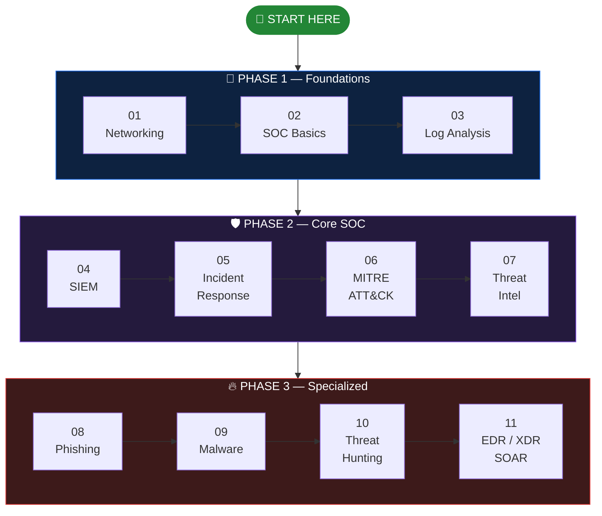

  

  
  

  
  
  

> يا هلا 👋 الرود ماب دي مش مجرد لينكات مرصوصة فوق بعض — دي مسار كامل بيوضحلك كل حاجة تقريبًا في مجال الـ SOC Analyst، هنمشي إن شاء الله عليه بشكل مرتب من النقطة 1 إلى النقطة 11 (وممكن يزيدوا، عادي). وحط في بالك إن كل نقطة بتبني على اللي قبلها، فلو وقفت مع حاجة أو مش فاهمها، اوعى تعديها — لازم تكون فهمتها كويس الأول.
>
> 📌 **ملاحظة مهمة:** الفيديو واللاب في كل خطوة هما **نقطة البداية** بس، مش كل المادة. المفروض تذاكر كل نقطة بنفسك وتدوّر وتقرا عنها من أكتر من مصدر، ومتقتصرش على الفيديوهات واللابات اللي هنا. وفي آخر الرود ماب قسم **Resources** فيه كورسات وكتب ومنصات لابات — ارجعله في كل خطوة وكمّل منه.
>
> ختامًا، بالتوفيق ليكم، وأتمنى تكون الـ roadmap سهلة عليكم.

---

## 🧭 The Path — Follow the Steps in Order

| Phase                        | Level                                                                                                   | Steps   | الهدف                                                |
| ---------------------------- | ------------------------------------------------------------------------------------------------------- | ------- | ---------------------------------------------------- |
| 🌱 **Phase 1 — Foundations** |                        | 01 → 03 | تفهم الشبكات ودور الـ SOC والسجلات                   |
| 🛡️ **Phase 2 — Core SOC**    |                | 04 → 07 | الـ SIEM والاستجابة للحوادث وMITRE والـ Threat Intel |
| 🔥 **Phase 3 — Specialized** |                        | 08 → 11 | Phishing وMalware وThreat Hunting والأدوات الآلية    |

---

## 📋 Table of Contents

| Step   |     | Topic                        |
| ------ | --- | ---------------------------- |
| **01** | 🌐  | Networking Fundamentals      |
| **02** | 🛡️  | SOC Analyst Fundamentals     |
| **03** | 📜  | Windows & Linux Log Analysis |
| **04** | 📊  | SIEM (Splunk)               |
| **05** | 🚨  | Incident Response            |
| **06** | 🗺️  | MITRE ATT&CK Framework       |
| **07** | 🕵️  | Threat Intelligence          |
| **08** | 🎣  | Phishing Email Analysis      |
| **09** | 🦠  | Malware Analysis             |
| **10** | 🔍  | Threat Hunting               |
| **11** | ⚙️  | EDR / XDR / SOAR             |

> كل خطوة = فيديو + لاب عملي. دوس على الصورة أو العنوان عشان تفتح الفيديو.

---

## 🌱 Phase 1 — Foundations

### 🌐 STEP 01 — Networking Fundamentals

<table>
<tr>
<td width="42%" align="center">

</td>
<td>

▶️ [Networking Fundamentals Playlist — Emad Nashat (23 videos)](https://www.youtube.com/playlist?list=PL8s4OGp0649_e_Wbz5MlBgW5rBW-9hD0c)

بلاي ليست عربية كاملة (23 فيديو) بتشرح أساسيات الشبكات من الصفر بجرافيك احترافي وواضح.

🧪 **لاب:** [TryHackMe | Introductory Networking](https://tryhackme.com/room/introtonetworking)

</td>
</tr>
</table>

### 🛡️ STEP 02 — SOC Analyst Fundamentals

<table>
<tr>
<td width="42%" align="center">

</td>
<td>

▶️ [SOC Analyst Roadmap — MyDFIR](https://youtu.be/OXzDbxphBuA)

شرح خطوات الوصول لوظيفة محلل SOC والأدوات والمهارات اللي محتاجها عشان تبدأ في المجال ده من الصفر.

🧪 **لاب:** [TryHackMe | Principles of Security](https://tryhackme.com/room/principlesofsecurity)

</td>
</tr>
</table>

### 📜 STEP 03 — Windows & Linux Log Analysis

<table>
<tr>
<td width="42%" align="center">

</td>
<td>

▶️ [CVEs in Windows Event Logs? What You Need to Know](https://www.youtube.com/watch?v=ebmW42YYveI)

بيشرح إزاي تلاقي آثار ثغرات معروفة (CVEs) جوه سجلات أحداث وندوز وتربط بينهم.

🧪 **لاب:** [TryHackMe | Investigating Windows](https://tryhackme.com/room/investigatingwindows)

</td>
</tr>
</table>

## 🛡️ Phase 2 — Core SOC

### 📊 STEP 04 — SIEM (Splunk)

<table>
<tr>
<td width="42%" align="center">

</td>
<td>

▶️ [Splunk SIEM Explained: A Beginner's Guide In Arabic](https://www.youtube.com/watch?v=H8rH-ogb3mE)

شرح مبسط لنظام إدارة الأحداث الأمنية الأشهر عالميًا وإزاي بيجمع ويحلل بيانات الشبكة.

🧪 **لاب:** [TryHackMe | Splunk](https://tryhackme.com/room/bpsplunk)

</td>
</tr>
</table>

### 🚨 STEP 05 — Incident Response

<table>
<tr>
<td width="42%" align="center">

</td>
<td>

▶️ [Incident Response Process Explained](https://www.youtube.com/watch?v=76fuTjzuiLg)

شرح عام لمراحل التعامل مع أي حادثة أمنية، من أول ما تتكشف لحد ما تتقفل.

🧪 **لاب:** [TryHackMe | Investigating Windows 2.0](https://tryhackme.com/room/investigatingwindows2)

</td>
</tr>
</table>

### 🗺️ STEP 06 — MITRE ATT&CK Framework

<table>
<tr>
<td width="42%" align="center">

</td>
<td>

▶️ [MITRE ATT&CK Framework — Official Video](https://www.youtube.com/watch?v=0BEf6s1iu5g)

الفيديو الرسمي من MITRE نفسها بيشرح إطار تصنيف أساليب الهجوم الأشهر عالميًا.

🧪 **لاب:** [TryHackMe | MITRE](https://tryhackme.com/room/mitre)

</td>
</tr>
</table>

### 🕵️ STEP 07 — Threat Intelligence

<table>
<tr>
<td width="42%" align="center">

</td>
<td>

▶️ [2026 Threat Intelligence Index: Ransomware, AI, & Emerging TTP Risks](https://www.youtube.com/watch?v=RKeW4Xd9V9E)

تقرير حديث بيستعرض أحدث اتجاهات التهديدات، وأثر الذكاء الاصطناعي على أساليب الهجوم.

🧪 **لاب:** [TryHackMe | Investigating Windows 3.x](https://tryhackme.com/room/investigatingwindows3)

</td>
</tr>
</table>

## 🔥 Phase 3 — Specialized

### 🎣 STEP 08 — Phishing Email Analysis

<table>
<tr>
<td width="42%" align="center">

</td>
<td>

▶️ [Phishing Email Analysis](https://youtu.be/8--EU8ngqqs)

من أكتر المهام تكرارًا لمحلل المستوى الأول: فحص الهيدر، عدم فتح الروابط مباشرة، وفحص المرفقات في بيئة معزولة.

🧪 **لاب:** [TryHackMe | Phishing: HiddenEye](https://tryhackme.com/room/phishinghiddeneye)

</td>
</tr>
</table>

### 🦠 STEP 09 — Malware Analysis

<table>
<tr>
<td width="42%" align="center">

</td>
<td>

▶️ [Malware Analysis — How to Get Started](https://www.youtube.com/watch?v=sBuxwMAfGnI)

مقدمة عملية لإزاي تبدأ في تحليل البرمجيات الخبيثة من غير خبرة سابقة.

🧪 **لاب:** [TryHackMe | Basic Malware RE](https://tryhackme.com/room/basicmalwarere)

</td>
</tr>
</table>

### 🔍 STEP 10 — Threat Hunting

<table>
<tr>
<td width="42%" align="center">

</td>
<td>

▶️ [Threat Hunting](https://youtu.be/VNp35Uw_bSM)

شرح عام لفكرة البحث الاستباقي عن التهديدات المخفية جوه الشبكة قبل ما تتسبب في ضرر.

🧪 **لاب:** [TryHackMe | Carnage](https://tryhackme.com/room/c2carnage)

</td>
</tr>
</table>

### ⚙️ STEP 11 — EDR / XDR / SOAR

<table>
<tr>
<td width="42%" align="center">

</td>
<td>

▶️ [EDR vs XDR vs SOAR Explained](https://youtu.be/TAaRA4ctRL4)

أدوات بتراقب الأجهزة وتوقف العمليات الخبيثة فورًا، وتعمل أتمتة لخطوات الاستجابة المتكررة.

🧪 **لاب:** [TryHackMe | Blue](https://tryhackme.com/room/blue)

</td>
</tr>
</table>

🏁 **Done with the 11 steps**

---

## 📚 Resources

### 🎬 Courses & Paths

| Resource                                                                                                              | Type        | Details                                                                                                              |
| --------------------------------------------------------------------------------------------------------------------- | ----------- | -------------------------------------------------------------------------------------------------------------------- |
| [Professor Messer — Security+](https://www.professormesser.com/)                                                      | 🎥 Videos    | أساسيات الأمن، مناسب للـ Phase 1                                                                                     |
| [CyberTalents — SOC Analyst L1 Career Path](https://cybertalents.com/courses/cybertalents-soc-analyst-l1-career-path) | 🎓 Full path | 48 درس و55 لاب وحوالي 26 ساعة، بيبدأ بأساسيات الأمن وبعدين وحدة SOC Analyst                                          |
| [Cybrary — SOC Analyst Path](https://www.cybrary.it/)                                                                 | 🎓 Platform  | كورسات ولابات مجمعة (بعضها بيحتاج اشتراك)                                                                            |
| [MyDFIR — SOC Analyst Roadmap (video)](https://youtu.be/OXzDbxphBuA)                                                  | 🎥 Video     | شرح رود ماب SOC من قناة MyDFIR، وليه نسخة PDF مدفوعة على [Gumroad](https://mydfir.gumroad.com/l/SOC-Analyst-Roadmap) |
| [Google Cybersecurity Certificate](https://www.coursera.org/professional-certificates/google-cybersecurity)           | 🎓 Course    | مدخل منظم لأساسيات الأمن السيبراني من الصفر (على Coursera)                                                           |
| [Splunk — Free Training](https://www.splunk.com/en_us/training/free-courses/overview.html)                            | 🎓 Course    | كورسات مجانية من Splunk نفسها، مناسبة للخطوة 04                                                                      |

### 📖 Books

| Book                                        | Author                           |
| ------------------------------------------- | -------------------------------- |
| Blue Team Handbook: SOC, SIEM               | Don Murdoch                      |
| The Practice of Network Security Monitoring | Richard Bejtlich                 |
| Incident Response & Computer Forensics      | Jason T. Luttgens & Matthew Pepe |
| Applied Incident Response                   | Steve Antony                     |
| Practical Packet Analysis                   | Chris Sanders                    |
| Practical Malware Analysis                  | Michael Sikorski & Andrew Honig  |

### 🧪 Labs & Practice Platforms

| Platform                                                                | بتتميز بإيه                        |
| ----------------------------------------------------------------------- | ---------------------------------- |
| [TryHackMe — SOC Level 1](https://tryhackme.com/path/outline/soclevel1) | مسار منظم من الصفر                 |
| [CyberDefenders](https://cyberdefenders.org/)                           | تحديات Blue Team حقيقية بأسلوب CTF |
| [BlueTeamLabs (BTLO)](https://blueteamlabs.online/)                     | تمارين تحليل وDFIR عملية           |
| [LetsDefend](https://letsdefend.io/)                                    | محاكاة بيئة SOC حقيقية بالتنبيهات  |
| [Any.Run](https://app.any.run/)                                         | تشغيل وتحليل الملفات المشبوهة أونلاين |

### 🔗 Tools & References

| Resource                                                                                                  | بتستفيد منه في إيه                                |
| --------------------------------------------------------------------------------------------------------- | ------------------------------------------------- |
| [MITRE ATT&CK](https://attack.mitre.org/)                                                                 | المرجع الرسمي لأساليب الهجوم (الخطوة 06)          |
| [NIST SP 800-61 — Incident Handling Guide](https://csrc.nist.gov/publications/detail/sp/800-61/rev-2/final) | الدليل الأشهر لمراحل الاستجابة للحوادث (الخطوة 05) |
| [Wireshark Docs](https://www.wireshark.org/docs/)                                                         | تحليل الشبكة والـ Packets (الخطوة 01)             |
| [VirusTotal](https://www.virustotal.com/)                                                                 | فحص الملفات والروابط والـ Hashes                  |
| [AlienVault OTX](https://otx.alienvault.com/)                                                             | مصدر مفتوح للـ Threat Intelligence (الخطوة 07)    |
| [AbuseIPDB](https://www.abuseipdb.com/)                                                                   | فحص سمعة الـ IP                                   |
| [MXToolbox](https://mxtoolbox.com/)                                                                       | فحص الإيميلات والـ Headers (الخطوة 08)            |
| [MalwareBazaar](https://bazaar.abuse.ch/)                                                                 | عينات برمجيات خبيثة للتحليل (الخطوة 09)           |
| [SigmaHQ — Detection Rules](https://github.com/SigmaHQ/sigma)                                            | قواعد كشف جاهزة للـ SIEM والـ Threat Hunting      |
| [Atomic Red Team](https://github.com/redcanaryco/atomic-red-team)                                         | اختبارات صغيرة تحاكي الهجمات عشان تتدرب على كشفها |

### 📰 Blogs & YouTube Channels

| Resource                                         | Type      | Details                                           |
| ------------------------------------------------ | --------- | ------------------------------------------------- |
| [The DFIR Report](https://thedfirreport.com/)    | 📰 Blog    | تقارير حقيقية عن هجمات وإزاي اتحققت خطوة بخطوة    |
| [MyDFIR](https://www.youtube.com/@MyDFIR)        | 🎥 Channel | محتوى عملي لمحللي الـ SOC ومشاريع Home Lab        |
| [John Hammond](https://www.youtube.com/@_JohnHammond) | 🎥 Channel | تحليل Malware وCTF وشروحات عملية                  |
| [13Cubed](https://www.youtube.com/@13Cubed)      | 🎥 Channel | شروحات DFIR والتحقيق الرقمي                       |

---

⭐ لو الرود ماب فادتك، سيب نجمة على الريبو

  

