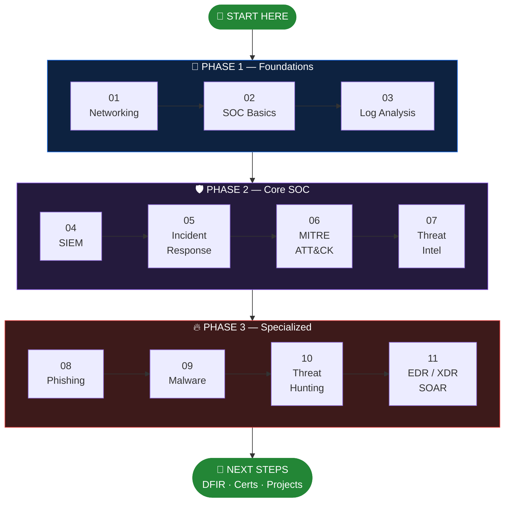

   

> يا هلا 👋 الرود ماب دي مش مجرد لينكات مرصوصة فوق بعض — دي مسار كامل بيوضحلك كل حاجة تقريبًا في مجال الـ SOC Analyst، هنمشي إن شاء الله عليه بشكل مرتب من النقطة 1 إلى النقطة 11 (وممكن يزيدوا، عادي). وحط في بالك إن كل نقطة بتبني على اللي قبلها، فلو وقفت مع حاجة أو مش فاهمها، اوعى تعديها — لازم تكون فهمتها كويس الأول. ختامًا، بالتوفيق ليكم، وأتمنى تكون الـ roadmap سهلة عليكم.

---

## 🧭 The Path — Follow the Steps in Order

| Phase | Level | Steps | الهدف |
|-------|-------|-------|-------|
| 🌱 **Phase 1 — Foundations** |  | 01 → 03 | تفهم الشبكات ودور الـ SOC والسجلات |
| 🛡️ **Phase 2 — Core SOC** |  | 04 → 07 | الـ SIEM والاستجابة للحوادث وMITRE والـ Threat Intel |
| 🔥 **Phase 3 — Specialized** |  | 08 → 11 | Phishing وMalware وThreat Hunting والأدوات الآلية |
| 🚀 **Next Steps** |  | After 11 | DFIR، شهادات، ومشاريع |

---

## 📋 Table of Contents

| Step | | Topic | Phase | ▶ Video |
|:----:|:-:|-------|:-----:|:-----:|
| **01** | 🌐 | Networking Fundamentals | 1 | 🇪🇬 |
| **02** | 🛡️ | SOC Analyst Fundamentals | 1 | 🇬🇧 |
| **03** | 📜 | Windows & Linux Log Analysis | 1 | 🇬🇧 |
| **04** | 📊 | SIEM (Splunk) | 2 | 🇪🇬 |
| **05** | 🚨 | Incident Response | 2 | 🇬🇧 |
| **06** | 🗺️ | MITRE ATT&CK Framework | 2 | 🇬🇧 |
| **07** | 🕵️ | Threat Intelligence | 2 | 🇬🇧 |
| **08** | 🎣 | Phishing Email Analysis | 3 | 🇬🇧 |
| **09** | 🦠 | Malware Analysis | 3 | 🇬🇧 |
| **10** | 🔍 | Threat Hunting | 3 | 🇬🇧 |
| **11** | ⚙️ | EDR / XDR / SOAR | 3 | 🇬🇧 |

> 🇪🇬 = Arabic video &nbsp;·&nbsp; 🇬🇧 = English video &nbsp;·&nbsp; كل خطوة = فيديو + لاب عملي. دوس على الصورة أو العنوان عشان تفتح الفيديو.

---

## 🌱 Phase 1 — Foundations

### 🌐 STEP 01 — Networking Fundamentals

<table>
<tr>
<td width="40%" align="center"></td>
<td>
▶️ <b>Video:</b> <a href="https://www.youtube.com/playlist?list=PL8s4OGp0649_e_Wbz5MlBgW5rBW-9hD0c">Networking Fundamentals Playlist — Emad Nashat (23 videos)</a> 🇪🇬  
بلاي ليست عربية كاملة (23 فيديو) بتشرح أساسيات الشبكات من الصفر بجرافيك احترافي وواضح.  
🧪 <b>لاب:</b> <a href="https://tryhackme.com/room/introtonetworking">TryHackMe | Introductory Networking</a>  
➡️ <b>Next:</b> Step 02 — SOC Analyst Fundamentals
</td>
</tr>
</table>

### 🛡️ STEP 02 — SOC Analyst Fundamentals

<table>
<tr>
<td width="40%" align="center"></td>
<td>
▶️ <b>Video:</b> <a href="https://www.youtube.com/watch?v=XswhNZ436tM">BEST Beginner SOC Analyst Roadmap</a> 🇬🇧  
شرح عام لدور محلل الـSOC وإزاي تبدأ في المجال ده من الصفر من غير خبرة سابقة.  
🧪 <b>لاب:</b> <a href="https://tryhackme.com/room/principlesofsecurity">TryHackMe | Principles of Security</a>  
➡️ <b>Next:</b> Step 03 — Windows & Linux Log Analysis
</td>
</tr>
</table>

### 📜 STEP 03 — Windows & Linux Log Analysis

<table>
<tr>
<td width="40%" align="center"></td>
<td>
▶️ <b>Video:</b> <a href="https://www.youtube.com/watch?v=ebmW42YYveI">CVEs in Windows Event Logs? What You Need to Know</a> 🇬🇧  
بيشرح إزاي تلاقي آثار ثغرات معروفة (CVEs) جوه سجلات أحداث وندوز وتربط بينهم.  
🧪 <b>لاب:</b> <a href="https://tryhackme.com/room/investigatingwindows">TryHackMe | Investigating Windows</a>  
➡️ <b>Next:</b> Step 04 — SIEM (Splunk)
</td>
</tr>
</table>

## 🛡️ Phase 2 — Core SOC

### 📊 STEP 04 — SIEM (Splunk)

<table>
<tr>
<td width="40%" align="center"></td>
<td>
▶️ <b>Video:</b> <a href="https://www.youtube.com/watch?v=H8rH-ogb3mE">Splunk SIEM Explained: A Beginner's Guide In Arabic</a> 🇪🇬  
شرح مبسط لنظام إدارة الأحداث الأمنية الأشهر عالميًا وإزاي بيجمع ويحلل بيانات الشبكة.  
🧪 <b>لاب:</b> <a href="https://tryhackme.com/room/bpsplunk">TryHackMe | Splunk</a>  
➡️ <b>Next:</b> Step 05 — Incident Response
</td>
</tr>
</table>

### 🚨 STEP 05 — Incident Response

<table>
<tr>
<td width="40%" align="center"></td>
<td>
▶️ <b>Video:</b> <a href="https://www.youtube.com/watch?v=76fuTjzuiLg">Incident Response Process Explained</a> 🇬🇧  
شرح عام لمراحل التعامل مع أي حادثة أمنية، من أول ما تتكشف لحد ما تتقفل.  
🧪 <b>لاب:</b> <a href="https://tryhackme.com/room/investigatingwindows2">TryHackMe | Investigating Windows 2.0</a>  
➡️ <b>Next:</b> Step 06 — MITRE ATT&CK Framework
</td>
</tr>
</table>

### 🗺️ STEP 06 — MITRE ATT&CK Framework

<table>
<tr>
<td width="40%" align="center"></td>
<td>
▶️ <b>Video:</b> <a href="https://www.youtube.com/watch?v=0BEf6s1iu5g">MITRE ATT&CK Framework — Official Video</a> 🇬🇧  
الفيديو الرسمي من MITRE نفسها بيشرح إطار تصنيف أساليب الهجوم الأشهر عالميًا.  
🧪 <b>لاب:</b> <a href="https://tryhackme.com/room/mitre">TryHackMe | MITRE</a>  
➡️ <b>Next:</b> Step 07 — Threat Intelligence
</td>
</tr>
</table>

### 🕵️ STEP 07 — Threat Intelligence

<table>
<tr>
<td width="40%" align="center"></td>
<td>
▶️ <b>Video:</b> <a href="https://www.youtube.com/watch?v=RKeW4Xd9V9E">2026 Threat Intelligence Index: Ransomware, AI, & Emerging TTP Risks</a> 🇬🇧  
تقرير حديث بيستعرض أحدث اتجاهات التهديدات، وأثر الذكاء الاصطناعي على أساليب الهجوم.  
🧪 <b>لاب:</b> <a href="https://tryhackme.com/room/investigatingwindows3">TryHackMe | Investigating Windows 3.x</a>  
➡️ <b>Next:</b> Step 08 — Phishing Email Analysis
</td>
</tr>
</table>

## 🔥 Phase 3 — Specialized

### 🎣 STEP 08 — Phishing Email Analysis

<table>
<tr>
<td width="40%" align="center"></td>
<td>
▶️ <b>Video:</b> <a href="https://youtu.be/8--EU8ngqqs">Phishing Email Analysis</a> 🇬🇧  
من أكتر المهام تكرارًا لمحلل المستوى الأول: فحص الهيدر، عدم فتح الروابط مباشرة، وفحص المرفقات في بيئة معزولة.  
🧪 <b>لاب:</b> <a href="https://tryhackme.com/room/phishinghiddeneye">TryHackMe | Phishing: HiddenEye</a>  
➡️ <b>Next:</b> Step 09 — Malware Analysis
</td>
</tr>
</table>

### 🦠 STEP 09 — Malware Analysis

<table>
<tr>
<td width="40%" align="center"></td>
<td>
▶️ <b>Video:</b> <a href="https://www.youtube.com/watch?v=sBuxwMAfGnI">Malware Analysis — How to Get Started</a> 🇬🇧  
مقدمة عملية لإزاي تبدأ في تحليل البرمجيات الخبيثة من غير خبرة سابقة.  
🧪 <b>لاب:</b> <a href="https://tryhackme.com/room/basicmalwarere">TryHackMe | Basic Malware RE</a>  
➡️ <b>Next:</b> Step 10 — Threat Hunting
</td>
</tr>
</table>

### 🔍 STEP 10 — Threat Hunting

<table>
<tr>
<td width="40%" align="center"></td>
<td>
▶️ <b>Video:</b> <a href="https://youtu.be/VNp35Uw_bSM">Threat Hunting</a> 🇬🇧  
شرح عام لفكرة البحث الاستباقي عن التهديدات المخفية جوه الشبكة قبل ما تتسبب في ضرر.  
🧪 <b>لاب:</b> <a href="https://tryhackme.com/room/c2carnage">TryHackMe | Carnage</a>  
➡️ <b>Next:</b> Step 11 — EDR / XDR / SOAR
</td>
</tr>
</table>

### ⚙️ STEP 11 — EDR / XDR / SOAR

<table>
<tr>
<td width="40%" align="center"></td>
<td>
▶️ <b>Video:</b> <a href="https://youtu.be/TAaRA4ctRL4">EDR vs XDR vs SOAR Explained</a> 🇬🇧  
أدوات بتراقب الأجهزة وتوقف العمليات الخبيثة فورًا، وتعمل أتمتة لخطوات الاستجابة المتكررة.  
🧪 <b>لاب:</b> <a href="https://tryhackme.com/room/blue">TryHackMe | Blue</a>  
🏁 <b>Done with the 11 steps</b> — continue to Next Steps below
</td>
</tr>
</table>

---

## 🚀 Next Steps — After the 11

### ✅ Job-Ready Checklist
- [ ] فاهم الشبكات كويس وتقدر تقرا Packet أو Log من غير ما تتلخبط
- [ ] اشتغلت على SIEM واحد على الأقل (Splunk مثلًا) وعملت Query بنفسك
- [ ] تقدر تشرح مراحل الـ Incident Response وتربط أي حادثة بـ MITRE ATT&CK
- [ ] حليت لاب لكل نقطة من الـ 11 (مش مجرد فرجة على الفيديو)
- [ ] كتبت Report بسيط لحادثة واحدة على الأقل من اللابات

### 🧬 DFIR Path
الـ DFIR مش نقطة بداية من الصفر — الأغلب بيوصله بعد ما يشتغل SOC Analyst، لإن شغل Tier 1 وTier 2 بيبني خبرة الـ Triage وتحليل السجلات والاستجابة للحوادث اللي الـ DFIR بيعتمد عليها.

| Resource | Type | إيه اللي هتاخده منه |
|----------|------|---------------------|
| [SANS DFIR Course Roadmap & Job Role Matrix](https://www.sans.org/blog/sans-dfir-course-roadmap-and-job-role-matrix/) | 🗺️ Roadmap | ترتيب كورسات DFIR وإيه الكورس المناسب لكل وظيفة |
| [TryHackMe — How to Get Started in DFIR](https://tryhackme.com/resources/blog/how-to-get-started-in-dfir-free-training-tools-and-career-path-in-2026) | 📝 Article | الأدوات والمهارات ومسار الوظيفة |
| [Cybrary — DFIR Operator Series: Overview](https://www.cybrary.it/course/dfir-overview) | 🎓 Course | يعني إيه DFIR، الأدلة الرقمية، وتطور دور المحلل (الوصول الكامل بيحتاج اشتراك) |

### 🎓 Certifications

| Level | Certification | ملاحظة |
|-------|---------------|--------|
|  | CompTIA Security+ | أساسيات عامة، وكورس Professor Messer بيغطيها |
|  | TryHackMe SAL1 (Security Analyst Level 1) | مبنية على مسار SOC Level 1 |
|  | TryHackMe SAL2 (Security Analyst Level 2) | تحقيق متقدم وDFIR بسيناريوهات عملية |
|  | EC-Council CND | تدعيم لمسار الـ Network Defense |
|  | EC-Council CHFI + ECIH | الشهادتين دول هما الـ Capstone لمسار DFIR عند EC-Council |
|  | GIAC (مرتبطة بكورسات SANS) | معروفة جدًا عند أصحاب الشغل |

---

## 📚 Resources

### 🎬 Courses & Paths

| Resource | Type | Details |
|----------|------|---------|
| [Professor Messer — Security+](https://www.professormesser.com/) | 🎥 Videos | أساسيات الأمن، مناسب للـ Phase 1 |
| [CyberTalents — SOC Analyst L1 Career Path](https://cybertalents.com/courses/cybertalents-soc-analyst-l1-career-path) | 🎓 Full path | 48 درس و55 لاب وحوالي 26 ساعة، بيبدأ بأساسيات الأمن وبعدين وحدة SOC Analyst |
| [Cybrary — SOC Analyst Path](https://www.cybrary.it/) | 🎓 Platform | كورسات ولابات مجمعة (بعضها بيحتاج اشتراك) |
| [MyDFIR — SOC Analyst Roadmap (video)](https://youtu.be/OXzDbxphBuA) 🇬🇧 | 🎥 Video | شرح رود ماب SOC من قناة MyDFIR، وليه نسخة PDF مدفوعة على [Gumroad](https://mydfir.gumroad.com/l/SOC-Analyst-Roadmap) |

### 📖 Books

| Book | Author |
|------|--------|
| Blue Team Handbook: SOC, SIEM | Don Murdoch |
| The Practice of Network Security Monitoring | Richard Bejtlich |
| Incident Response & Computer Forensics | Jason T. Luttgens & Matthew Pepe |
| Applied Incident Response | Steve Antony |

### 🧪 Labs & Practice Platforms

| Platform | بتتميز بإيه |
|----------|-------------|
| [TryHackMe — SOC Level 1](https://tryhackme.com/path/outline/soclevel1) | مسار منظم من الصفر |
| [CyberDefenders](https://cyberdefenders.org/) | تحديات Blue Team حقيقية بأسلوب CTF |
| [BlueTeamLabs (BTLO)](https://blueteamlabs.online/) | تمارين تحليل وDFIR عملية |
| [LetsDefend](https://letsdefend.io/) | محاكاة بيئة SOC حقيقية بالتنبيهات |

---

⭐ لو الرود ماب فادتك، سيب نجمة على الريبو

