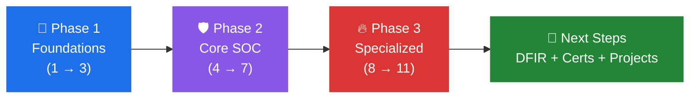

   

> يا هلا 👋 الرود ماب دي مش مجرد لينكات مرصوصة فوق بعض — دي مسار كامل بيوضحلك كل حاجة تقريبًا في مجال الـ SOC Analyst، هنمشي إن شاء الله عليه بشكل مرتب من النقطة 1 إلى النقطة 11 (وممكن يزيدوا، عادي). وحط في بالك إن كل نقطة بتبني على اللي قبلها، فلو وقفت مع حاجة أو مش فاهمها، اوعى تعديها — لازم تكون فهمتها كويس الأول. ختامًا، بالتوفيق ليكم، وأتمنى تكون الـ roadmap سهلة عليكم.

---

## 🧭 The Path

| Phase | Level | Steps | الهدف |
|-------|-------|-------|-------|
| 🌱 **Phase 1 — Foundations** |  | 1 → 3 | تفهم الشبكات ودور الـ SOC والسجلات |
| 🛡️ **Phase 2 — Core SOC** |  | 4 → 7 | الـ SIEM والاستجابة للحوادث وMITRE والـ Threat Intel |
| 🔥 **Phase 3 — Specialized** |  | 8 → 11 | Phishing وMalware وThreat Hunting والأدوات الآلية |
| 🚀 **Next Steps** |  | بعد 11 | DFIR، شهادات، ومشاريع |

---

## 📋 Table of Contents

| # | 🔖 | Section |
|---|---|---------|
| 1 | 🌐 | أساسيات الشبكات |
| 2 | 🛡️ | أساسيات دور محلل SOC |
| 3 | 📜 | تحليل سجلات الأنظمة (Windows/Linux) |
| 4 | 📊 | إدارة الأحداث الأمنية (SIEM/Splunk) |
| 5 | 🚨 | الاستجابة للحوادث الأمنية |
| 6 | 🗺️ | إطار MITRE ATT&CK |
| 7 | 🕵️ | استخبارات التهديدات |
| 8 | 🎣 | تحليل رسائل التصيد الاحتيالي |
| 9 | 🦠 | تحليل البرمجيات الخبيثة |
| 10 | 🔍 | البحث الاستباقي عن التهديدات |
| 11 | ⚙️ | أدوات الحماية والاستجابة الآلية (EDR/XDR/SOAR) |

---

## 🌱 Phase 1 — Foundations

🌐 &nbsp;<b>1. أساسيات الشبكات</b>

 

**1. [قائمة تشغيل: أساسيات الشبكات — عماد نشأت](https://www.youtube.com/playlist?list=PL8s4OGp0649_e_Wbz5MlBgW5rBW-9hD0c)** 🇪🇬
بلاي ليست عربية كاملة (23 فيديو) بتشرح أساسيات الشبكات من الصفر بجرافيك احترافي وواضح.
🧪 لاب: [TryHackMe | Introductory Networking](https://tryhackme.com/room/introtonetworking)

🛡️ &nbsp;<b>2. أساسيات دور محلل SOC</b>

 

**2. [BEST Beginner SOC Analyst Roadmap](https://www.youtube.com/watch?v=XswhNZ436tM)** 🇬🇧
شرح عام لدور محلل الـSOC وإزاي تبدأ في المجال ده من الصفر من غير خبرة سابقة.
🧪 لاب: [TryHackMe | Principles of Security](https://tryhackme.com/room/principlesofsecurity)

📜 &nbsp;<b>3. تحليل سجلات الأنظمة (Windows/Linux)</b>

 

**3. [CVEs in Windows Event Logs? What You Need to Know](https://www.youtube.com/watch?v=ebmW42YYveI)** 🇬🇧
بيشرح إزاي تلاقي آثار ثغرات معروفة (CVEs) جوه سجلات أحداث وندوز وتربط بينهم.
🧪 لاب: [TryHackMe | Investigating Windows](https://tryhackme.com/room/investigatingwindows)

---

## 🛡️ Phase 2 — Core SOC

📊 &nbsp;<b>4. إدارة الأحداث الأمنية (SIEM/Splunk)</b>

 

**4. [شرح Splunk SIEM للمبتدئين بالعربي](https://www.youtube.com/watch?v=H8rH-ogb3mE)** 🇪🇬
شرح مبسط لنظام إدارة الأحداث الأمنية الأشهر عالميًا وإزاي بيجمع ويحلل بيانات الشبكة.
🧪 لاب: [TryHackMe | Splunk](https://tryhackme.com/room/bpsplunk)

🚨 &nbsp;<b>5. الاستجابة للحوادث الأمنية</b>

 

**5. [Incident Response Process Explained](https://www.youtube.com/watch?v=76fuTjzuiLg)** 🇬🇧
شرح عام لمراحل التعامل مع أي حادثة أمنية، من أول ما تتكشف لحد ما تتقفل.
🧪 لاب: [TryHackMe | Investigating Windows 2.0](https://tryhackme.com/room/investigatingwindows2)

🗺️ &nbsp;<b>6. إطار MITRE ATT&CK</b>

 

**6. [MITRE ATT&CK Framework — الفيديو الرسمي](https://www.youtube.com/watch?v=0BEf6s1iu5g)** 🇬🇧
الفيديو الرسمي من MITRE نفسها بيشرح إطار تصنيف أساليب الهجوم الأشهر عالميًا.
🧪 لاب: [TryHackMe | MITRE](https://tryhackme.com/room/mitre)

🕵️ &nbsp;<b>7. استخبارات التهديدات</b>

 

**7. [2026 Threat Intelligence Index: Ransomware, AI, & Emerging TTP Risks](https://www.youtube.com/watch?v=RKeW4Xd9V9E)** 🇬🇧
تقرير حديث بيستعرض أحدث اتجاهات التهديدات، وأثر الذكاء الاصطناعي على أساليب الهجوم.
🧪 لاب: [TryHackMe | Investigating Windows 3.x](https://tryhackme.com/room/investigatingwindows3)

---

## 🔥 Phase 3 — Specialized

🎣 &nbsp;<b>8. تحليل رسائل التصيد الاحتيالي</b>

 

**8. [Phishing Email Analysis](https://youtu.be/8--EU8ngqqs)** 🇬🇧
من أكتر المهام تكرارًا لمحلل المستوى الأول: فحص الهيدر، عدم فتح الروابط مباشرة، وفحص المرفقات في بيئة معزولة.
🧪 لاب: [TryHackMe | Phishing: HiddenEye](https://tryhackme.com/room/phishinghiddeneye)

🦠 &nbsp;<b>9. تحليل البرمجيات الخبيثة</b>

 

**9. [Malware Analysis — How to Get Started](https://www.youtube.com/watch?v=sBuxwMAfGnI)** 🇬🇧
مقدمة عملية لإزاي تبدأ في تحليل البرمجيات الخبيثة من غير خبرة سابقة.
🧪 لاب: [TryHackMe | Basic Malware RE](https://tryhackme.com/room/basicmalwarere)

🔍 &nbsp;<b>10. البحث الاستباقي عن التهديدات</b>

 

**10. [Threat Hunting](https://youtu.be/VNp35Uw_bSM)** 🇬🇧
شرح عام لفكرة البحث الاستباقي عن التهديدات المخفية جوه الشبكة قبل ما تتسبب في ضرر.
🧪 لاب: [TryHackMe | Carnage](https://tryhackme.com/room/c2carnage)

⚙️ &nbsp;<b>11. أدوات الحماية والاستجابة الآلية (EDR/XDR/SOAR)</b>

 

**11. [EDR vs XDR vs SOAR Explained](https://youtu.be/TAaRA4ctRL4)** 🇬🇧
أدوات بتراقب الأجهزة وتوقف العمليات الخبيثة فورًا، وتعمل أتمتة لخطوات الاستجابة المتكررة.
🧪 لاب: [TryHackMe | Blue](https://tryhackme.com/room/blue)

---

## 🚀 Next Steps — بعد ما تخلص الـ 11

### ✅ Checklist قبل ما تقدم على أي وظيفة
- [ ] فاهم الشبكات كويس وتقدر تقرا Packet أو Log من غير ما تتلخبط
- [ ] اشتغلت على SIEM واحد على الأقل (Splunk مثلًا) وعملت Query بنفسك
- [ ] تقدر تشرح مراحل الـ Incident Response وتربط أي حادثة بـ MITRE ATT&CK
- [ ] حليت لاب لكل نقطة من الـ 11 (مش مجرد فرجة على الفيديو)
- [ ] كتبت Report بسيط لحادثة واحدة على الأقل من اللابات

### 🧬 مسار DFIR (التحقيق الجنائي الرقمي)
الـ DFIR مش نقطة بداية من الصفر — الأغلب بيوصله بعد ما يشتغل SOC Analyst، لإن شغل Tier 1 وTier 2 بيبني خبرة الـ Triage وتحليل السجلات والاستجابة للحوادث اللي الـ DFIR بيعتمد عليها.

| المصدر | النوع | إيه اللي هتاخده منه |
|--------|-------|---------------------|
| [SANS DFIR Course Roadmap & Job Role Matrix](https://www.sans.org/blog/sans-dfir-course-roadmap-and-job-role-matrix/) | 🗺️ خريطة رسمية | ترتيب كورسات DFIR وإيه الكورس المناسب لكل وظيفة |
| [TryHackMe — How to Get Started in DFIR](https://tryhackme.com/resources/blog/how-to-get-started-in-dfir-free-training-tools-and-career-path-in-2026) | 📝 مقال | الأدوات والمهارات ومسار الوظيفة |
| [Cybrary — DFIR Operator Series: Overview](https://www.cybrary.it/course/dfir-overview) | 🎓 كورس | يعني إيه DFIR، الأدلة الرقمية، وتطور دور المحلل (الوصول الكامل بيحتاج اشتراك) |

### 🎓 الشهادات المقترحة

| المستوى | الشهادة | ملاحظة |
|---------|---------|--------|
|  | CompTIA Security+ | أساسيات عامة، وكورس Professor Messer بيغطيها |
|  | TryHackMe SAL1 (Security Analyst Level 1) | مبنية على مسار SOC Level 1 |
|  | TryHackMe SAL2 (Security Analyst Level 2) | تحقيق متقدم وDFIR بسيناريوهات عملية |
|  | EC-Council CND | تدعيم لمسار الـ Network Defense |
|  | EC-Council CHFI + ECIH | الشهادتين دول هما الـ Capstone لمسار DFIR عند EC-Council |
|  | GIAC (مرتبطة بكورسات SANS) | معروفة جدًا عند أصحاب الشغل |

---

## 📚 Resources

### 🎬 كورسات ومسارات شاملة

| المصدر | النوع | التفاصيل |
|--------|-------|----------|
| [Professor Messer — Security+](https://www.professormesser.com/) | 🎥 فيديوهات | أساسيات الأمن، مناسب للـ Phase 1 |
| [CyberTalents — SOC Analyst L1 Career Path](https://cybertalents.com/courses/cybertalents-soc-analyst-l1-career-path) | 🎓 مسار كامل | 48 درس و55 لاب وحوالي 26 ساعة، بيبدأ بأساسيات الأمن وبعدين وحدة SOC Analyst |
| [Cybrary — SOC Analyst Path](https://www.cybrary.it/) | 🎓 منصة | كورسات ولابات مجمعة (بعضها بيحتاج اشتراك) |
| [MyDFIR — SOC Analyst Roadmap (فيديو)](https://youtu.be/OXzDbxphBuA) 🇬🇧 | 🎥 فيديو | شرح رود ماب SOC من قناة MyDFIR، وليه نسخة PDF مدفوعة على [Gumroad](https://mydfir.gumroad.com/l/SOC-Analyst-Roadmap) |

### 📖 كتب

| الكتاب | المؤلف |
|--------|--------|
| Blue Team Handbook: SOC, SIEM | Don Murdoch |
| The Practice of Network Security Monitoring | Richard Bejtlich |
| Incident Response & Computer Forensics | Jason T. Luttgens & Matthew Pepe |
| Applied Incident Response | Steve Antony |

### 🧪 لابات ومنصات تمرين

| المنصة | بتتميز بإيه |
|--------|-------------|
| [TryHackMe — SOC Level 1](https://tryhackme.com/path/outline/soclevel1) | مسار منظم من الصفر |
| [CyberDefenders](https://cyberdefenders.org/) | تحديات Blue Team حقيقية بأسلوب CTF |
| [BlueTeamLabs (BTLO)](https://blueteamlabs.online/) | تمارين تحليل وDFIR عملية |
| [LetsDefend](https://letsdefend.io/) | محاكاة بيئة SOC حقيقية بالتنبيهات |

---

⭐ لو الرود ماب فادتك، سيب نجمة على الريبو

